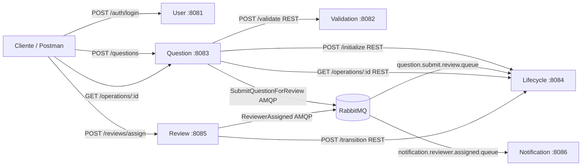

# Taller 09 — Banco de Preguntas Saber PRO

**Universidad del Cauca · Laboratorio de Ingeniería de Software II · 2026-2**  
**Tecnologías:** Java 17, Spring Boot 3.4.4, Spring Web, Spring AMQP, RabbitMQ, H2/JPA, Maven, Docker Compose y Postman.

Este monorepo implementa el escenario del taller: login, creación y validación síncrona, envío asíncrono a revisión, transiciones centralizadas, asignación de revisores y notificación asíncrona. Los seis servicios se ejecutan por separado y no comparten base de datos.

## 1. Servicios y responsabilidades

| Carpeta | Puerto | Función | Persistencia |
|---|---:|---|---|
| `user-service` | 8081 | Login, sesión opaca, consulta de roles | Usuarios demo/sesiones en memoria |
| `validation-service` | 8082 | Validación de enunciado, 4 opciones, clave | Sin base de datos |
| `question-service` | 8083 | Contenido de preguntas, validación REST, publica comando | H2 propia (preguntas y solicitudes) |
| `lifecycle-service` | 8084 | **Autoridad exclusiva** sobre los estados, consume comando | H2 propia (estados y resultados) |
| `review-service` | 8085 | Revisor, decisión, evento `ReviewerAssigned` | H2 propia (asignaciones) |
| `notification-service` | 8086 | Consume evento, simula notificación | H2 propia (notificaciones) |

### Arquitectura



**Estados permitidos**: `DRAFT → PENDING_REVIEW → IN_REVIEW → APPROVED → PUBLISHED` o `IN_REVIEW → REJECTED → DRAFT` (corrección y segunda ronda). No se puede pasar directamente `DRAFT → APPROVED`; el rechazo exige motivo.

## 2. Inicio rápido: todos los servicios con Docker

**Requisitos:** Docker Desktop con Docker Compose (y puertos 5672, 15672, 8081–8086 libres).

Desde la raíz:

```bash
docker compose up --build -d
docker compose ps
docker compose logs -f
```

La primera ejecución descarga imágenes y compila los proyectos Maven. Espera a que los servicios terminen de iniciar antes de probar. Los datos se guardan en volúmenes de Docker. Para detener sin eliminar datos:

```bash
docker compose down
```

**Panel RabbitMQ:** http://localhost:15672 — usuario `saberpro`, contraseña `saberpro123` (solo entorno de desarrollo). Revisar pestañas **Exchanges**, **Queues and Streams** y **Connections**; deben aparecer `saberpro.direct.exchange`, `question.submit.review.queue`, `saberpro.events.exchange`, `notification.reviewer.assigned.queue`.

> Si ya se usó un volumen de RabbitMQ con otras credenciales, las variables de `.env` no reconfiguran automáticamente el usuario persistido. No elimine volúmenes sin necesidad.

## 3. Alternativa: microservicios locales, solo RabbitMQ en Docker

**Requisitos:** JDK 17+, Maven 3.9+, Docker Desktop. Desde la raíz:

```bash
docker compose up -d rabbitmq
mvn clean test
```

Abrir **seis terminales**, una por servicio, y ejecutar (cada comando desde la raíz):

```bash
cd user-service && mvn spring-boot:run
cd validation-service && mvn spring-boot:run
cd lifecycle-service && mvn spring-boot:run
cd question-service && mvn spring-boot:run
cd review-service && mvn spring-boot:run
cd notification-service && mvn spring-boot:run
```

Cada terminal usa su propia carpeta del proyecto. Las bases H2 se almacenan en `data/` de los servicios correspondientes. Los archivos `.mv.db` están ignorados por Git.

Comprobar la disponibilidad en el navegador:

- http://localhost:8081/actuator/health
- http://localhost:8082/actuator/health
- http://localhost:8083/actuator/health
- http://localhost:8084/actuator/health
- http://localhost:8085/actuator/health
- http://localhost:8086/actuator/health

## 4. Postman (entregable incluido)

Importar ambos archivos de `/postman`:

1. `SaberPro_Microservices.postman_collection.json`
2. `Taller09_Local.postman_environment.json`

Seleccionar **Taller09_Local** como entorno. **Ejecutar primero los tres logins**; sus scripts guardan automáticamente `teacher_token`, `admin_token` y `reviewer_token`. Al crear una pregunta se guarda `question_id`; al enviarla a revisión se guarda `operation_id`; al asignar un revisor se guardan `assignment_id` y `event_id`.

**Credenciales de ejemplo (únicamente para laboratorio):**

| Usuario | Contraseña por defecto | Roles |
|---|---|---|
| `docente` | `Demo123!` | `TEACHER`, `AUTHOR` |
| `administrador` | `Demo123!` | `ADMIN` |
| `revisor` | `Demo123!` | `REVIEWER` |

Cambiar con `DEMO_PASSWORD` en la configuración; actualizar también `demo_password` en Postman. El token es **opaco en memoria**, no JWT, en coherencia con la restricción del taller de no implementar JWT todavía. Se envía en `Authorization: Bearer <accessToken>`. Al reiniciar `user-service`, se debe iniciar sesión de nuevo.

### Flujo principal comprobable

1. `POST :8081/auth/login`: docente autorizado, `401` con clave incorrecta.
2. `POST :8083/questions`: el servicio llama a `:8082/validate`; pregunta válida → **201** y `DRAFT`, inválida → **400** y detalles de errores.
3. `POST :8083/questions/{id}/submit`: comando JSON `SubmitQuestionForReview` vía RabbitMQ → **202 Accepted**, `operationId` y `PROCESSING`.
4. **Consultar repetidamente** `GET :8083/operations/{operationId}` hasta `COMPLETED` (o `FAILED`). `202` no significa que el estado haya cambiado ya. `GET :8084/lifecycle/{id}` confirma `PENDING_REVIEW`.
5. `POST :8085/reviews/assign` con rol admin, `questionId` y `reviewerId=3`. El Review Service llama a Lifecycle (`PENDING_REVIEW → IN_REVIEW`), registra la asignación y publica el evento `ReviewerAssigned`.
6. `GET :8086/notifications`: aparece registro con `SENT_SIMULATED`. Ver la cola en RabbitMQ: puede estar vacía porque el consumidor la procesa inmediatamente; las **Connections/Exchanges** siguen mostrando infraestructura.
7. `POST :8085/reviews/{id}/decision` con rol revisor para `REJECTED` + motivo. `PUT :8083/questions/{id}` corrige y vuelve a `DRAFT`. Enviar de nuevo, reasignar en otra ronda y decidir `APPROVED`. La colección de Postman cubre ambas rutas.
8. `POST :8084/lifecycle/{id}/transition` con `APPROVED → PUBLISHED` completa el ciclo de demostración.

**Importante:** entre enviar a revisión y asignar, comprobar manualmente que el resultado de la operación sea `COMPLETED`; un Collection Runner sin espera puede intentar asignar demasiado pronto y recibir `409` correctamente.

### Ejemplos mínimos

**Crear pregunta:**

```http
POST http://localhost:8083/questions
Authorization: Bearer <teacher_token>
Content-Type: application/json

{
  "statement": "En Java, ¿cuál palabra clave permite heredar de una clase?",
  "options": [
    {"id":"A","text":"implements"},
    {"id":"B","text":"extends"},
    {"id":"C","text":"import"},
    {"id":"D","text":"package"}
  ],
  "correctOptionId": "B"
}
```

**Asignar revisor (después de COMPLETED):**

```http
POST http://localhost:8085/reviews/assign
Authorization: Bearer <admin_token>
Content-Type: application/json

{"questionId":1,"reviewerId":3}
```

## 5. Pruebas fallidas y resiliencia

| Escenario | Resultado esperado |
|---|---|
| Clave incorrecta o sesión inválida | 401 Unauthorized |
| Autor sin sesión | 401 Unauthorized |
| Pregunta con menos de 4 opciones / clave inexistente | 400; no se guarda |
| Validation Service caído | 503; no se guarda |
| Aprobar directamente desde DRAFT | 409 Conflict; estado intacto |
| Repetir submit cuando ya no es DRAFT | 409 Conflict |
| Intentar asignar sin PENDING_REVIEW | 409 Conflict |
| Usuario sin rol REVIEWER como candidato | 400 Bad Request |
| Rechazar sin motivo | 400 Bad Request |
| Mensaje asíncrono que no puede transicionar | `GET /operations/{id}` devuelve `FAILED` con detalle |
| Error incierto al confirmar transición de asignación | Queda `RESERVED`; `POST /reviews/{id}/reconcile` revisa estado antes de seguir |
| Error al publicar notificación | Asignación `NOTIFICATION_PENDING`; `POST /reviews/{id}/retry-notification` |
| Mensaje de notificación duplicado | No se crea notificación duplicada (por `eventId`) |

**Nota técnica:** La reserva de asignación evita afirmar que una transición se confirmó ante un error de red. La reconciliación manual está implementada con fines didácticos, pero no constituye una saga distribuida completamente automática. Del mismo modo, la entrega fiable de mensajes a nivel de broker necesitaría confirmaciones de publicación y un patrón outbox para producción.

## 6. Contratos AMQP

- Exchange directo durable: `saberpro.direct.exchange`, routing key `question.submit`, cola durable `question.submit.review.queue`.
- Mensaje `SubmitQuestionForReview`: `{"questionId": 1, "operationId": "UUID"}`.
- Exchange de eventos durable: `saberpro.events.exchange`, routing key `reviewer.assigned`, cola durable `notification.reviewer.assigned.queue`.
- Evento `ReviewerAssigned`: `eventId`, `assignmentId`, `questionId`, `reviewerId`, `occurredAt`.
- Serialización JSON mediante `Jackson2JsonMessageConverter` en publicadores y consumidores.

**Pruebas automáticas:** `mvn test` desde la raíz. Se incluyen pruebas JUnit/Mockito para login, validación estructural, reglas del ciclo de vida, duplicación de comandos y notificaciones.

## 7. Evidencias e informe técnico

Se incluye `lisw2_taller09_gX.docx`, un **borrador técnico editable**. La plantilla oficial `Formato-Documento.docx` **no fue suministrada**; antes de entregar, traslade su contenido al formato oficial, reemplace `X` por el número del grupo, agregue los nombres de los integrantes (máximo dos) y su enlace **público** del repositorio GitHub.

**Capturas que usted debe tomar tras ejecutar** (no se inventaron capturas):

- Docker Compose mostrando los servicios activos.
- RabbitMQ Management en `http://localhost:15672` (Exchanges, Queues and Streams y Connections).
- Postman: 201 creación válida, 400 validación inválida, 202 `operationId`, consulta `COMPLETED`, 409 transición inválida, asignación de revisor y notificación.

## 8. Consideraciones de seguridad y alcance

**Desarrollo académico local, no despliegue público.** Contraseñas demo compartidas, tokens opacos en memoria y rutas internas `/lifecycle/*`, `/users/{id}` sin autenticación entre microservicios. Para producción se requeriría autenticación y autorización central, TLS, secretos, persistencia robusta, políticas de red y observabilidad. El caso de uso completo de simulacros y estadísticas del proyecto general no forma parte de este taller de comunicaciones.

### Limpiar y reconstruir

```bash
# Reconstruir imágenes sin borrar datos
docker compose up --build -d

# Borra TODOS los datos de laboratorio (¡irreversible!)
docker compose down -v
```

No suba a GitHub los archivos `.mv.db`, contraseñas reales, `target/` ni registros personales.
